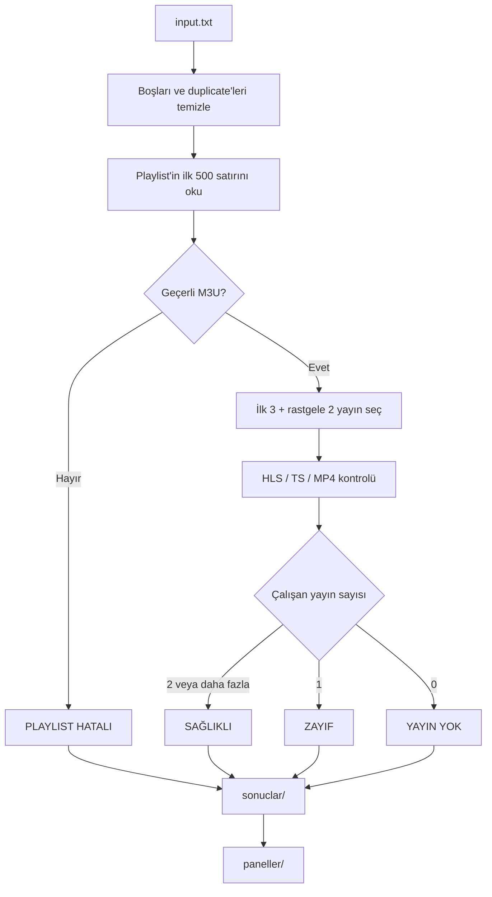

<div align="center">

# 🎬 IPTV Checker

**Playlist'lerinizi dakikalar içinde tarayın, gerçekten çalışan yayınları görün.**

[](https://www.python.org/)
[](https://requests.readthedocs.io/)
[](https://rich.readthedocs.io/)
[](LICENSE)
[](#-testler)
[](#-kurulum)

[Öne Çıkanlar](#-öne-çıkanlar) • [Kurulum](#-kurulum) • [Hızlı Başlangıç](#-hızlı-başlangıç) • [Örnek Dosyalar](examples/) • [English](#english)

</div>

---

> [!IMPORTANT]
> **Güvenlik önce gelir:** `input.txt`, `sonuclar/` ve `paneller/` gerçek kullanıcı adı/şifre içerebilir. Bu dosyalar `.gitignore` ile korunur ve repoya **asla** eklenmemelidir. Depodaki `examples/` klasöründe yalnızca **tamamen sahte** örnekler bulunur.

## 🌟 Neden IPTV Checker?

Çoğu playlist kontrol aracı yalnızca "URL 200 döndü mü?" diye bakar. IPTV Checker bununla yetinmez:

- Playlist'in gerçekten **geçerli M3U** olup olmadığını kontrol eder.
- İçinden seçtiği yayınların **gerçekten medya verisi** döndürüp döndürmediğini doğrular.
- HLS manifestlerini, variant'ları ve segmentleri takip eder.
- Sonuçları anlaşılır kategorilere ayırır.
- Panel ve kullanıcı bilgilerini düzenli bir envanter olarak tutar.

Kısacası: **çalışıyor gibi görünen** değil, **gerçekten çalışan** yayınları bulur.

## ✨ Öne Çıkanlar

| | Özellik |
|---|---|
| ⚡ | **Hız odaklı:** 40 MB'lık playlist'i tamamen indirmez, yalnızca ilk 500 satırı okur. |
| 🖥️ | **Canlı terminal paneli:** İlerleme, durum sayaçları, son 10 çalışan panel ve gerçekçi kalan süre tek ekranda. |
| 🏠 | **Host farkındalıklı eşzamanlılık:** Aynı paneli yormamak için host başına görev ve HTTP bağlantı limiti. |
| 🎲 | **Rastgele tarama sırası:** İşler karıştırılarak taranır; raporlar yine `input.txt` sırasını korur. |
| 🎯 | **Akıllı örnekleme:** İlk 3 yayını sırayla, kalan 2 yayını ilk 500 satırdan rastgele seçer. |
| 🔍 | **Gerçek doğrulama:** HTTP 200 tek başına yeterli değildir; HLS segmenti veya TS/MP4 medya baytı aranır. |
| 📊 | **Net raporlar:** `SAĞLIKLI`, `ZAYIF`, `YAYIN YOK`, `PLAYLIST HATALI` olarak ayrı dosyalara yazılır. |
| 🧾 | **Panel envanteri:** Erişilebilen paneller ve `username:password` kayıtları tutulur. |
| 🔁 | **Çoklu panel gruplama:** Aynı kullanıcı bilgisi 2+ panelde geçiyorsa `AyniUserpass.txt` ile gruplanır. |
| 🛡️ | **Güvenlik bilinci:** Gerçek veriler `.gitignore` ile korunur; repoda yalnızca sahte örnekler vardır. |
| 🧪 | **Test edilmiş:** Yerel mock sunucuyla çalışan 11 otomatik test içerir. |
| 🪶 | **Hafif:** Yalnızca iki harici bağımlılık: `requests` ve `rich`. |

## 📦 Hızlı Bakış

| Özellik | Değer |
|---|---|
| **Girdi** | `input.txt` — satır başına bir playlist URL'si |
| **Çıktı** | `sonuclar/<YYYY-MM-DD-HH-MM>/` — her tarama için ayrı klasör |
| **Panel kayıtları** | `paneller/` — paneller, kullanıcı bilgileri, eşleşmeler |
| **Dil** | Python 3.10+ |
| **Bağımlılık** | `requests`, `rich` |
| **Test** | 11 yerel test, gerçek ağ bağlantısı gerektirmez |
| **Platform** | Windows, Linux, macOS |

## 🛠️ Kurulum

```bash
git clone https://github.com/furkanckkmus/iptv-checker.git
cd iptv-checker
pip install -r requirements.txt
```

## ⚡ Hızlı Başlangıç

1. `examples/input.example.txt` dosyasını `input.txt` olarak kopyalayın.
2. Gerçek playlist adreslerinizi `input.txt` içine yazın.
3. Programı çalıştırın:

```bash
python iptv_checker.py
```

Program aynı anda kaç playlist kontrol edileceğini sorar:

```text
Aynı anda kontrol edilecek playlist sayısı (varsayılan 20):
```

İsterseniz yolları komut satırından da verebilirsiniz:

```bash
python iptv_checker.py input.txt sonuclar
```

### Canlı terminal gösterimi

Program terminalde çalışırken Rich tabanlı gösterge paneli ekranı 0,5 saniyede bir yeniler. İlerleme, durum sayaçları ve son çalışan paneller tek ekranda gösterilir:

```text
📺 IPTV CHECKER
📡 Toplam: 161   ✅ Tamamlanan: 42 (%26.1)   ⏳ Kalan: 119
🔄 Paralel: 20   🏠 Host limiti: 4           ⏱️  Süre: 00:01:24
🚀 Hız (ort.): 0.50 işlem/sn  🕒 Tahmini: 00:03:58  🎯 Şu an: #43, #44…
[██████████░░░░░░░░░░░░░░░░░░░░░░] %26.1

✅ Sağlıklı: 8   ⚠️ Zayıf: 2   ❌ Yayın yok: 5   ⛔ Hatalı: 25   ⏳ Zaman aşımı: 2

Son çalışanlar (10)
✅ panel-a.example:8080    5/5
⚠️ panel-b.example:2095    1/5
```

Gösterilen bilgiler:

- Toplam, tamamlanan ve kalan işlem sayısı, yüzde ve ilerleme çubuğu
- Paralel iş sayısı ve host başına eşzamanlı iş limiti
- Durum sayaçları: sağlıklı, zayıf, yayın yok, hatalı, zaman aşımı
- Son 10 çalışan panel (yalnızca `host:port`, kimlik bilgisi değil)
- Geçen süre, işlem hızı ve tahmini kalan süre
- Şu an işlenen işlem numaraları

> Tarama %90'a ulaştığında hız ve kalan süre, son dilimin gerçek hızına göre yeniden hesaplanır; böylece sona kalan yavaş işlerde ETA iyimser görünmez.

> `rich` kurulu değilse veya çıktı bir dosyaya yönlendirilmişse program otomatik olarak satır satır çıktı moduna geçer.

### Örnek satır satır çıktı

```text
🔍 IPTV Checker
📄 Girdi: input.txt
🔗 Kontrol edilecek adres: 161

🚀 Başlıyor (5 playlist paralel)...

[   1/161] SAĞLIKLI (3/5)          demo-panel.example:8080
[   2/161] ZAYIF (1/5)             panel-b.example:2095
[   3/161] YAYIN YOK (0/5)         panel-c.example:8080
[   4/161] PLAYLIST HATALI         bad-panel.example:8080
```

## 📂 Proje Yapısı

```text
iptv-checker/
├── iptv_checker.py          # Ana program
├── requirements.txt         # Python bağımlılıkları
├── README.md                # Türkçe + İngilizce dokümantasyon
├── LICENSE                  # MIT lisansı
├── .gitignore               # Gerçek verileri korur
├── examples/                # Sahte örnek girdi ve çıktılar
│   ├── input.example.txt
│   ├── playlist.example.m3u
│   ├── stream.example.m3u8
│   ├── sonuclar/
│   └── paneller/
└── tests/
    └── test_checker.py      # Yerel mock sunucu testleri
```

## 📥 Girdi Formatı

`input.txt` içinde her satırda bir adres bulunmalıdır:

```text
http://demo-panel.example:8080/get.php?username=demo&password=demo123&type=m3u_plus
http://panel-b.example:2095/get.php?username=test&password=test123&type=m3u
https://demo-stream.example/live/example.m3u8
```

Desteklenen biçimler:

- ✅ `get.php?...type=m3u`
- ✅ `get.php?...type=m3u_plus`
- ✅ Doğrudan `.m3u8` adresleri

Kurallar:

- Boş satırlar yok sayılır.
- `#` ile başlayan satırlar yorum kabul edilir.
- Birebir aynı URL'ler yalnızca bir kez kontrol edilir.
- Sıralama ilk görülme sırasına göre korunur.

## 🎯 Durumlar

| Durum | Koşul | Renk |
|---|---|---|
| ✅ `SAĞLIKLI` | En az 2 yayın çalışıyor | Yeşil |
| ⚠️ `ZAYIF` | Yalnızca 1 yayın çalışıyor | Sarı |
| ❌ `YAYIN YOK` | Playlist açılıyor ama hiçbir yayın çalışmıyor | Kırmızı |
| ⛔ `PLAYLIST HATALI` | URL açılmıyor, HTML/boş/geçersiz M3U veya HTTP hatası | Koyu kırmızı |

## 📁 Çıktı Dosyaları

Tarama sonunda her çalıştırma için ayrı, zaman damgalı bir klasör oluşturulur:

```text
sonuclar/
├── 2026-11-08-23-32/
│   ├── saglikli.txt
│   ├── zayif.txt
│   ├── yayin_yok.txt
│   ├── playlist_hatali.txt
│   └── ozet.txt
├── 2026-11-09-00-15/
│   └── ...
└── ...
```

- Klasör adı biçimi: `YYYY-MM-DD-HH-MM`
- Aynı dakika içinde ikinci tarama başlarsa klasör adına `_2`, `_3` eklenir.
- Önceki taramaların klasörleri korunur; üzerine yazılmaz.
- Klasör içindeki dosya adları sabittir.

Her kategori dosyası iki bölümden oluşur:

1. **ADRESLER** — yalnızca URL listesi
2. **DETAYLAR** — HTTP kodu, süre, kontrol edilen/çalışan yayın sayısı, hata nedeni ve yayın bazlı sonuçlar

`ozet.txt` ise toplam sayıları, süreyi ve dosya bazlı dağılımı gösterir.

## 🗂️ Örnek Dosyalar

Gerçek veri içermeyen, biçimi gösteren örnekler:

| Örnek | Açıklama |
|---|---|
| [`examples/input.example.txt`](examples/input.example.txt) | Örnek `input.txt` |
| [`examples/playlist.example.m3u`](examples/playlist.example.m3u) | Örnek M3U kanal listesi |
| [`examples/stream.example.m3u8`](examples/stream.example.m3u8) | Örnek HLS medya playlist'i |
| [`examples/sonuclar/`](examples/sonuclar/) | Örnek kategori raporları |
| [`examples/paneller/`](examples/paneller/) | Örnek panel ve kullanıcı kayıtları |
| [`examples/output.example.txt`](examples/output.example.txt) | Eski birleşik `output.txt` biçimi |

> Tüm örneklerdeki adresler, kullanıcı adları ve şifreler **sahtedir**.

## 🔐 Panel ve Kullanıcı Kayıtları

Tarama tamamlandıktan sonra `paneller/` klasörü oluşturulur:

```text
paneller/
├── Paneller.txt
├── Userpass.txt
├── AyniUserpass.txt
└── eslesmeler.txt
```

| Dosya | İçerik |
|---|---|
| `Paneller.txt` | Erişilebilen paneller: `http://host:port/` |
| `Userpass.txt` | Benzersiz `username:password` kayıtları |
| `AyniUserpass.txt` | Aynı kullanıcı bilgisini kullanan 2+ panel |
| `eslesmeler.txt` | Panel ↔ kullanıcı eşleşmelerini tutan iç takip dosyası |

### Kayıt kuralları

- ✅ Playlist URL'si geçerli M3U döndürüyorsa panel kaydedilir.
- ✅ Geçerli M3U dönüyor ama içinde hiç yayın yoksa panel yine kaydedilir.
- ❌ HTTP hatası, HTML sayfası veya geçersiz M3U varsa panel kaydedilmez.
- ✅ URL'de `username` ve `password` varsa, panel açılmasa bile `Userpass.txt` dosyasına eklenir.
- 🔁 Tüm dosyalar append-only çalışır; mevcut kayıtlar tekrar eklenmez.
- 🕒 Sıralama ilk görülme sırasına göredir.

`AyniUserpass.txt` örneği:

```text
AYNI USERNAME:PASSWORD KULLANAN PANELLER
============================================================

demo:demo123
  http://demo-panel.example:8080/
  http://panel-c.example:8080/
```

## 🧠 Nasıl Çalışır?



### Teknik ayrıntılar

- 📥 Playlist yanıtı `stream=True` ile okunur ve **500 satır veya 4 MB** sınırında durdurulur.
- 🎯 Yayın seçimi: **ilk 3 sırayla, kalan 2 rastgele**.
- 📺 HLS kontrolünde master playlist'teki variant'lar, ardından medya segmentleri denenir.
- 📦 Segmentlerden yalnızca ilk birkaç KB okunur; tüm yayın indirilmez.
- 📡 MPEG-TS için `0x47` senkron baytı, MP4/fMP4 için `ftyp` imzası kontrol edilir.
- 🚫 HTML hata sayfaları ve boş yanıtlar çalışan yayın sayılmaz.
- ⏱️ Zaman aşımları: playlist **10 sn**, yayın **8 sn**, bağlantı **5 sn**.
- 🎭 Yayın isteklerinde VLC kullanıcı aracısı kullanılır.

## ⚙️ Ayarlar

Ayarlar `iptv_checker.py` dosyasının başındaki sabitlerden değiştirilebilir:

| Sabit | Varsayılan | Açıklama |
|---|---|---|
| `CONNECT_TIMEOUT` | `5` | Bağlantı zaman aşımı (sn) |
| `PLAYLIST_READ_TIMEOUT` | `10` | Playlist okuma zaman aşımı (sn) |
| `STREAM_READ_TIMEOUT` | `8` | Yayın okuma zaman aşımı (sn) |
| `MAX_PLAYLIST_LINES` | `500` | Okunacak maksimum satır |
| `MAX_PLAYLIST_BYTES` | `4 MB` | Okunacak maksimum bayt |
| `SAMPLE_SIZE` | `5` | Kontrol edilecek yayın sayısı |
| `MIN_WORKING` | `2` | Sağlıklı sayılmak için gereken çalışan yayın |
| `DEFAULT_PARALLELISM` | `20` | Soruda önerilen varsayılan paralel iş sayısı |
| `HOST_TASK_LIMIT` | `4` | Aynı host için eşzamanlı görev limiti |
| `HOST_HTTP_LIMIT` | `6` | Aynı host için eşzamanlı HTTP bağlantı limiti |

Paralellik program çalışırken sorulur; diğer limit sabitleri kodun başından değiştirilebilir.

## 🧪 Testler

Yerel mock sunucu kullanan testler:

```bash
python -m unittest discover -s tests -v
```

Test kapsamı:

- ✅ Durum sınıflandırması
- ✅ 500 satır limiti
- ✅ Yayın seçimi
- ✅ Kullanıcı bilgisi koruma
- ✅ Panel normalizasyonu
- ✅ Panel kayıtlarında duplicate engelleme
- ✅ Canlı terminal gösterge paneli
- ✅ %90 sonrası gerçek hız / ETA hesabı
- ✅ Zaman damgalı çıktı klasörleri ve sabit dosya adları
- ✅ Süre biçimlendirme ve host gösterimi

Testler **gerçek IPTV adreslerine istek atmaz**.

## 🛡️ Güvenlik

> [!WARNING]
> `input.txt`, `sonuclar/` ve `paneller/` gerçek kullanıcı adı/şifre içerebilir. Bu dosyaları Git'e eklemeyin, GitHub'a push etmeyin veya üçüncü kişilerle paylaşmayın.

- `.gitignore` bu dosyaları varsayılan olarak hariç tutar.
- Paylaşacağınız ekran görüntülerinde URL'leri ve kullanıcı bilgilerini maskeleyin.
- Yanlışlıkla gizli bilgi commit ederseniz, ilgili hesapların şifrelerini değiştirin.
- Bu araç yayın içeriğini indirmez, kaydetmez veya DRM korumasını aşmaz.

## ⚖️ Yasal Uyarı

Bu araç yalnızca erişim izniniz olan playlist'leri test etmek için kullanılmalıdır. Kullanımınızdan doğacak yasal sorumluluk size aittir. Yayın sağlayıcılarının kullanım koşullarına ve bulunduğunuz ülkenin yasalarına uyun.

## 🤝 Katkı

Katkılar memnuniyetle karşılanır:

```bash
git clone https://github.com/furkanckkmus/iptv-checker.git
cd iptv-checker
git checkout -b feature/yeni-ozellik
```

Değişiklikten önce ve sonra testleri çalıştırın:

```bash
python -m unittest discover -s tests -v
```

Ardından bir Pull Request açın.

## ⭐ Destek

Projeyi faydalı bulduysanız:

- ⭐ Repoya yıldız verin
- 🐛 Hata bildirin
- 💡 Yeni özellik önerin
- 🔗 Çevrenizle paylaşın

## 📄 Lisans

[MIT](LICENSE)

---

<a id="english"></a>

# 🇬🇧 English

**Scan your playlists in minutes and see which streams actually work.**

[](https://www.python.org/)
[](LICENSE)
[](#-tests)

> [!IMPORTANT]
> **Security first:** `input.txt`, `sonuclar/`, and `paneller/` may contain real credentials. They are excluded by `.gitignore` and must never be committed. All files under `examples/` are completely fake.

## ✨ Why IPTV Checker?

Most playlist checkers only ask: "Did the URL return HTTP 200?" IPTV Checker goes further:

- Verifies that the response is a real M3U playlist.
- Confirms that sampled streams return actual media data.
- Follows HLS manifests, variants, and segments.
- Groups results into clear categories.
- Keeps a clean inventory of panels and credentials.

It finds streams that **actually work**, not streams that merely **look like they work**.

## 🚀 Highlights

| | Feature |
|---|---|
| ⚡ | **Fast:** Reads only the first 500 lines instead of downloading a 40 MB playlist. |
| 🖥️ | **Live terminal dashboard:** Progress, status counters, the last 10 working panels, and a realistic ETA on one screen. |
| 🏠 | **Host-aware concurrency:** Per-host task and HTTP connection limits keep individual panels from being overloaded. |
| 🎲 | **Random scan order:** Work is shuffled, while reports still keep `input.txt` order. |
| 🎯 | **Smart sampling:** First 3 streams in order + 2 random streams from the first 500 lines. |
| 🔍 | **Real validation:** HTTP 200 is not enough; HLS segments or TS/MP4 media bytes are required. |
| 📊 | **Clear reports:** Separate files for `HEALTHY`, `WEAK`, `NO STREAM`, and `INVALID PLAYLIST`. |
| 🧾 | **Panel inventory:** Accessible panels and `username:password` records. |
| 🔁 | **Multi-panel grouping:** Credentials used on 2+ panels are grouped in `AyniUserpass.txt`. |
| 🛡️ | **Security aware:** Real data is excluded; only fake examples are committed. |
| 🧪 | **Tested:** 11 automated tests using a local mock server. |
| 🪶 | **Lightweight:** Only two external dependencies: `requests` and `rich`. |

## 🛠️ Installation

```bash
git clone https://github.com/furkanckkmus/iptv-checker.git
cd iptv-checker
pip install -r requirements.txt
```

## ⚡ Quick Start

```bash
cp examples/input.example.txt input.txt
# Add your own playlist URLs to input.txt
python iptv_checker.py
```

The program asks how many playlists to check concurrently:

```text
Aynı anda kontrol edilecek playlist sayısı (varsayılan 20):
```

You can also pass input and output paths:

```bash
python iptv_checker.py input.txt sonuclar
```

### Live terminal dashboard

When running in a terminal, a Rich-based dashboard refreshes every 0.5 seconds and shows progress, status counters, and the most recent working panels:

```text
📺 IPTV CHECKER
📡 Toplam: 161   ✅ Tamamlanan: 42 (%26.1)   ⏳ Kalan: 119
🔄 Paralel: 20   🏠 Host limiti: 4           ⏱️  Süre: 00:01:24
🚀 Hız (ort.): 0.50 işlem/sn  🕒 Tahmini: 00:03:58  🎯 Şu an: #43, #44…
[██████████░░░░░░░░░░░░░░░░░░░░░░] %26.1

✅ Sağlıklı: 8   ⚠️ Zayıf: 2   ❌ Yayın yok: 5   ⛔ Hatalı: 25   ⏳ Zaman aşımı: 2

Son çalışanlar (10)
✅ panel-a.example:8080    5/5
⚠️ panel-b.example:2095    1/5
```

It shows:

- Total, completed, and remaining items with percentage and progress bar
- Parallel workers and the per-host concurrency limit
- Status counters: healthy, weak, no stream, invalid, timed out
- The last 10 working panels (only `host:port`, never credentials)
- Elapsed time, processing speed, and estimated time remaining
- Current item numbers being processed

> Once the scan reaches 90%, speed and ETA are recalculated from the real rate of the final stretch, so the estimate stays realistic when slow items remain.

> If `rich` is not installed, or output is redirected to a file, the program automatically falls back to line-by-line output.

## 📂 Project Structure

```text
iptv-checker/
├── iptv_checker.py          # Main program
├── requirements.txt         # Python dependencies
├── README.md                # Turkish + English documentation
├── LICENSE                  # MIT license
├── .gitignore               # Protects real data
├── examples/                # Fake input and output samples
│   ├── input.example.txt
│   ├── playlist.example.m3u
│   ├── stream.example.m3u8
│   ├── sonuclar/
│   └── paneller/
└── tests/
    └── test_checker.py      # Local mock server tests
```

## 📥 Input Format

One URL per line:

```text
http://demo-panel.example:8080/get.php?username=demo&password=demo123&type=m3u_plus
http://panel-b.example:2095/get.php?username=test&password=test123&type=m3u
https://demo-stream.example/live/example.m3u8
```

Supported formats:

- ✅ `get.php?...type=m3u`
- ✅ `get.php?...type=m3u_plus`
- ✅ Direct `.m3u8` URLs

Rules:

- Blank lines are ignored.
- Lines starting with `#` are comments.
- Exact duplicate URLs are checked once.
- First-seen order is preserved.

## 🎯 Statuses

| Status | Condition |
|---|---|
| ✅ `SAĞLIKLI` / `HEALTHY` | At least 2 streams work |
| ⚠️ `ZAYIF` / `WEAK` | Exactly 1 stream works |
| ❌ `YAYIN YOK` / `NO STREAM` | Playlist opens but no stream works |
| ⛔ `PLAYLIST HATALI` / `INVALID PLAYLIST` | URL does not open, returns HTML/empty/invalid M3U, or HTTP error |

## 📁 Output Files

Each run writes its own timestamped folder:

```text
sonuclar/
├── 2026-11-08-23-32/
│   ├── saglikli.txt
│   ├── zayif.txt
│   ├── yayin_yok.txt
│   ├── playlist_hatali.txt
│   └── ozet.txt
├── 2026-11-09-00-15/
│   └── ...
└── ...
```

- Folder name format: `YYYY-MM-DD-HH-MM`
- If a second scan starts within the same minute, `_2`, `_3` is appended.
- Previous run folders are preserved; nothing is overwritten.
- File names inside the folder are fixed.

Each category file contains:

- **ADRESLER** — a plain URL list
- **DETAYLAR** — HTTP code, duration, checked/working stream counts, failure reasons, and per-stream results

`ozet.txt` contains totals, elapsed time, and per-file counts.

## 🗂️ Example Files

| Example | Description |
|---|---|
| [`examples/input.example.txt`](examples/input.example.txt) | Sample `input.txt` |
| [`examples/playlist.example.m3u`](examples/playlist.example.m3u) | Sample M3U channel list |
| [`examples/stream.example.m3u8`](examples/stream.example.m3u8) | Sample HLS media playlist |
| [`examples/sonuclar/`](examples/sonuclar/) | Sample category reports |
| [`examples/paneller/`](examples/paneller/) | Sample panel and credential records |
| [`examples/output.example.txt`](examples/output.example.txt) | Legacy combined `output.txt` format |

> All addresses, usernames, and passwords in the examples are fake.

## 🔐 Panel and Credential Records

```text
paneller/
├── Paneller.txt
├── Userpass.txt
├── AyniUserpass.txt
└── eslesmeler.txt
```

| File | Content |
|---|---|
| `Paneller.txt` | Accessible panels: `http://host:port/` |
| `Userpass.txt` | Unique `username:password` records |
| `AyniUserpass.txt` | Credentials used on 2+ panels |
| `eslesmeler.txt` | Internal panel ↔ credential mapping |

Recording rules:

- ✅ A panel is recorded if the playlist URL returns a valid M3U.
- ✅ A valid M3U with zero streams is still recorded.
- ❌ HTTP errors, HTML pages, and invalid M3U responses are not recorded as panels.
- ✅ Credentials are added to `Userpass.txt` even when the panel does not open.
- 🔁 All files are append-only; existing records are never duplicated.
- 🕒 First-seen order is preserved.

## 🧠 How It Works


Technical details:

- 📥 Playlist responses are streamed and stopped at **500 lines or 4 MB**.
- 🎯 Stream selection: **first 3 in order + 2 random**.
- 📺 HLS checks try master playlist variants, then media segments.
- 📦 Only the first few KB of each segment is read; streams are not fully downloaded.
- 📡 MPEG-TS uses the `0x47` sync byte; MP4/fMP4 uses the `ftyp` signature.
- 🚫 HTML error pages and empty responses are rejected.
- ⏱️ Timeouts: playlist **10 s**, stream **8 s**, connection **5 s**.
- 🎭 A VLC user agent is used for stream requests.

## ⚙️ Configuration

Edit the constants at the top of `iptv_checker.py`:

| Constant | Default | Description |
|---|---|---|
| `CONNECT_TIMEOUT` | `5` | Connection timeout (seconds) |
| `PLAYLIST_READ_TIMEOUT` | `10` | Playlist read timeout (seconds) |
| `STREAM_READ_TIMEOUT` | `8` | Stream read timeout (seconds) |
| `MAX_PLAYLIST_LINES` | `500` | Maximum lines to read |
| `MAX_PLAYLIST_BYTES` | `4 MB` | Maximum bytes to read |
| `SAMPLE_SIZE` | `5` | Streams to check |
| `MIN_WORKING` | `2` | Working streams required for healthy status |
| `DEFAULT_PARALLELISM` | `20` | Default parallel workers suggested at the prompt |
| `HOST_TASK_LIMIT` | `4` | Concurrent task limit per host |
| `HOST_HTTP_LIMIT` | `6` | Concurrent HTTP connection limit per host |

Parallelism is requested at runtime; the other limits are constants at the top of the script.

## 🧪 Tests

```bash
python -m unittest discover -s tests -v
```

The tests use a local mock server and never contact real IPTV services.

Coverage:

- ✅ Status classification
- ✅ 500-line playlist cap
- ✅ Stream sampling
- ✅ Credential preservation
- ✅ Panel normalization
- ✅ Panel record deduplication
- ✅ Live terminal dashboard
- ✅ Real-rate ETA after 90%
- ✅ Timestamped output folders with fixed file names
- ✅ Duration formatting and host display

## 🛡️ Security

> [!WARNING]
> `input.txt`, `sonuclar/`, and `paneller/` may contain real credentials. Never commit, push, or share these files.

- `.gitignore` excludes them by default.
- Redact URLs and credentials in screenshots.
- If you accidentally commit secrets, rotate the affected passwords.
- This tool does not download, store, or bypass DRM on any content.

## ⚖️ Legal Notice

Use this tool only against playlists you are authorized to test. You are responsible for complying with provider terms and local laws.

## 🤝 Contributing

```bash
git clone https://github.com/furkanckkmus/iptv-checker.git
cd iptv-checker
git checkout -b feature/my-feature
python -m unittest discover -s tests -v
```

Then open a Pull Request.

## ⭐ Support

If you find this project useful:

- ⭐ Star the repository
- 🐛 Report bugs
- 💡 Suggest features
- 🔗 Share it with others

## 📄 License

[MIT](LICENSE)
