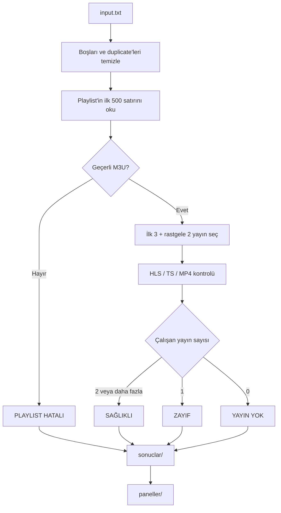
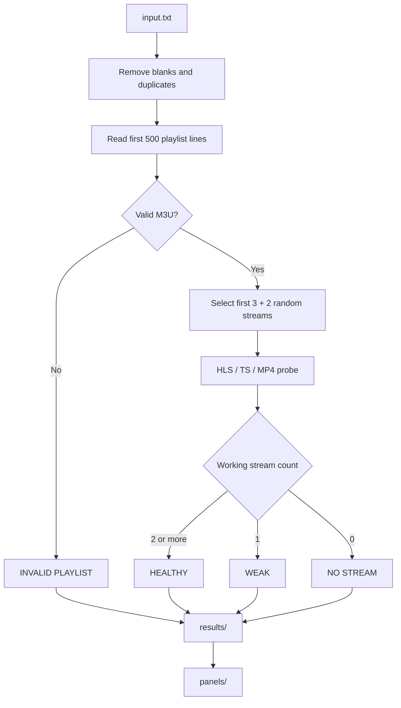

# IPTV Checker

M3U / Xtream Codes playlist'lerini ve içlerindeki yayınları kontrol eden Python aracı.

> **Türkçe** | [English](#english)

---

## Türkçe

### Ne yapar?

`input.txt` dosyasındaki her playlist adresi için iki aşamalı kontrol yapar:

1. Playlist adresi açılıyor ve geçerli bir M3U döndürüyor mu?
2. Playlist açılıyorsa, içinden seçilen yayınlardan en az 2 tanesi oynuyor mu?

Sonuçları durumlara göre ayrı TXT dosyalarına yazar. Ayrıca erişilebilen panelleri ve kullanıcı bilgilerini isteğe bağlı olarak kayıt altına alır.

### Özellikler

- Aynı URL'leri otomatik olarak tekilleştirir.
- 40 MB'lık playlist dosyalarını tamamen indirmez; yalnızca ilk 500 satırı okur.
- İlk 3 yayını sırayla, kalan 2 yayını ilk 500 satırdaki havuzdan rastgele seçer.
- Playlist'te 5'ten az yayın varsa mevcutların tamamını kontrol eder.
- HLS (`m3u8`) yayınlarında manifest → variant → segment zincirini doğrular.
- MPEG-TS yayınlarında `0x47` senkron baytını, MP4/fMP4 yayınlarında `ftyp` imzasını kontrol eder.
- HTML hata sayfalarını veya boş yanıtları çalışan yayın olarak kabul etmez.
- Playlist ve yayın kontrollerini paralel çalıştırır.
- Sonuçları `SAĞLIKLI`, `ZAYIF`, `YAYIN YOK` ve `PLAYLIST HATALI` olarak sınıflandırır.
- Erişilebilen panelleri ve kullanıcı bilgilerini ayrı dosyalarda tutar.
- Aynı `username:password` birden fazla panelde geçiyorsa bunları gruplar.

### Gereksinimler

- Python 3.10 veya üzeri
- `requests`

### Kurulum

```bash
git clone https://github.com/furkanckkmus/iptv-checker.git
cd iptv-checker
pip install -r requirements.txt
```

### Hızlı başlangıç

1. Proje klasöründe `input.txt` dosyası oluşturun.
2. Her satıra bir playlist adresi yazın.
3. Programı çalıştırın:

```bash
python iptv_checker.py
```

Program başlangıçta aynı anda kaç playlist kontrol edileceğini sorar:

```text
Aynı anda kontrol edilecek playlist sayısı (varsayılan 5):
```

İsterseniz giriş ve çıkış klasörünü komut satırından verebilirsiniz:

```bash
python iptv_checker.py input.txt sonuclar
```

### Girdi formatı

`input.txt` içinde her satırda bir adres bulunmalıdır:

```text
http://demo-panel.example:8080/get.php?username=demo&password=demo123&type=m3u_plus
http://demo-panel.example:8080/get.php?username=test&password=test123&type=m3u
https://demo-stream.example/live/example.m3u8
```

Desteklenen biçimler:

- `get.php?...type=m3u`
- `get.php?...type=m3u_plus`
- Doğrudan `.m3u8` adresleri

Boş satırlar ve `#` ile başlayan yorum satırları yok sayılır. Birebir aynı adresler tekrar kontrol edilmez.

### Durumlar

| Durum | Koşul |
|---|---|
| `SAĞLIKLI` | En az 2 yayın çalışıyor |
| `ZAYIF` | Yalnızca 1 yayın çalışıyor |
| `YAYIN YOK` | Playlist açılıyor ancak hiçbir yayın çalışmıyor |
| `PLAYLIST HATALI` | Playlist açılmıyor, HTML/boş/geçersiz M3U dönüyor veya HTTP hatası var |

### Çıktı dosyaları

Varsayılan olarak `sonuclar/` klasörü oluşturulur:

```text
sonuclar/
├── saglikli.txt
├── zayif.txt
├── yayin_yok.txt
├── playlist_hatali.txt
└── ozet.txt
```

Her kategori dosyası şunları içerir:

- Sadece adreslerin bulunduğu `ADRESLER` bölümü
- HTTP kodu, süre, kontrol edilen/çalışan yayın sayısı ve hata nedenini içeren `DETAYLAR` bölümü

`ozet.txt` toplam sayıları, süreyi ve dosya bazlı sonuçları gösterir.

### Panel ve kullanıcı kayıtları

Tarama tamamlandıktan sonra `paneller/` klasörü oluşturulur:

```text
paneller/
├── Paneller.txt
├── Userpass.txt
├── AyniUserpass.txt
└── eslesmeler.txt
```

| Dosya | İçerik |
|---|---|
| `Paneller.txt` | Erişilebilen paneller: `http://host:port/` |
| `Userpass.txt` | Benzersiz `username:password` kayıtları |
| `AyniUserpass.txt` | Aynı kullanıcı bilgisini kullanan 2+ panel |
| `eslesmeler.txt` | Panel ↔ kullanıcı eşleşmelerini tutan iç takip dosyası |

Kayıt kuralları:

- Playlist URL'si geçerli M3U döndürüyorsa panel kaydedilir.
- Geçerli M3U dönüyor ama içinde hiç yayın yoksa panel yine kaydedilir.
- HTTP hatası, HTML sayfası veya geçersiz M3U varsa panel kaydedilmez.
- URL'de `username` ve `password` varsa, panel açılmasa bile `Userpass.txt` dosyasına eklenir.
- Tüm dosyalar append-only çalışır; mevcut kayıtlar tekrar eklenmez.
- Sıralama ilk görülme sırasına göredir.

`AyniUserpass.txt` örneği:

```text
AYNI USERNAME:PASSWORD KULLANAN PANELLER
============================================================

demo:demo123
  http://panel-a.example:8080/
  http://panel-b.example:2095/
```

### Nasıl çalışır?



Teknik ayrıntılar:

- Playlist yanıtı `stream=True` ile okunur ve 500 satır veya 4 MB sınırında durdurulur.
- Yayın seçimi: ilk 3 sırayla, kalan 2 rastgele.
- HLS kontrolünde master playlist'teki variant'lar, ardından medya segmentleri denenir.
- Segmentlerden yalnızca ilk birkaç KB okunur; tüm yayın indirilmez.
- Zaman aşımları: playlist 10 sn, yayın 8 sn, bağlantı 5 sn.
- Yayın kontrollerinde VLC kullanıcı aracısı kullanılır.

### Ayarlar

Ayarlar `iptv_checker.py` dosyasının başındaki sabitlerden değiştirilebilir:

| Sabit | Varsayılan | Açıklama |
|---|---|---|
| `CONNECT_TIMEOUT` | `5` | Bağlantı zaman aşımı (sn) |
| `PLAYLIST_READ_TIMEOUT` | `10` | Playlist okuma zaman aşımı (sn) |
| `STREAM_READ_TIMEOUT` | `8` | Yayın okuma zaman aşımı (sn) |
| `MAX_PLAYLIST_LINES` | `500` | Okunacak maksimum satır |
| `MAX_PLAYLIST_BYTES` | `4 MB` | Okunacak maksimum bayt |
| `SAMPLE_SIZE` | `5` | Kontrol edilecek yayın sayısı |
| `MIN_WORKING` | `2` | Sağlıklı sayılmak için gereken çalışan yayın |

Paralellik program çalışırken sorulur.

### Testler

Yerel mock sunucu kullanan testler:

```bash
python -m unittest discover -s tests -v
```

Testler gerçek IPTV adreslerine istek atmaz.

### Güvenlik ve gizlilik

> **Önemli:** `input.txt`, `sonuclar/` ve `paneller/` gerçek kullanıcı adı/şifre içerebilir. Bu dosyaları Git'e eklemeyin, GitHub'a push etmeyin veya üçüncü kişilerle paylaşmayın.

- `.gitignore` bu dosyaları varsayılan olarak hariç tutar.
- Paylaşacağınız ekran görüntülerinde URL'leri ve kullanıcı bilgilerini maskeleyin.
- Yanlışlıkla gizli bilgi commit ederseniz, ilgili hesapların şifrelerini değiştirin.
- Bu araç yayın içeriğini indirmez, kaydetmez veya DRM korumasını aşmaz.

### Yasal uyarı

Bu araç yalnızca erişim izniniz olan playlist'leri test etmek için kullanılmalıdır. Kullanımınızdan doğacak yasal sorumluluk size aittir. Yayın sağlayıcılarının kullanım koşullarına ve bulunduğunuz ülkenin yasalarına uyun.

### Lisans

[MIT](LICENSE)

---

## English

### What does it do?

For every playlist URL in `input.txt`, the tool performs two checks:

1. Does the playlist URL open and return a valid M3U file?
2. If it opens, do at least 2 of the sampled streams actually play?

Results are written to separate TXT files grouped by status. Optionally, accessible panels and credentials can also be recorded.

### Features

- Deduplicates identical input URLs.
- Does not download a full 40 MB playlist; it reads only the first 500 lines.
- Selects the first 3 streams in order and 2 random streams from the first 500 lines.
- Checks all available streams when the playlist contains fewer than 5.
- Validates HLS (`m3u8`) streams through manifest → variant → segment.
- Checks the `0x47` sync byte for MPEG-TS and the `ftyp` signature for MP4/fMP4.
- Rejects HTML error pages and empty responses.
- Runs playlist and stream checks in parallel.
- Classifies results as `HEALTHY`, `WEAK`, `NO STREAM`, and `INVALID PLAYLIST`.
- Records accessible panels and credentials separately.
- Groups credentials that appear on multiple panels.

### Requirements

- Python 3.10+
- `requests`

### Installation

```bash
git clone https://github.com/furkanckkmus/iptv-checker.git
cd iptv-checker
pip install -r requirements.txt
```

### Quick start

1. Create an `input.txt` file in the project directory.
2. Put one playlist URL on each line.
3. Run:

```bash
python iptv_checker.py
```

The program asks for the number of playlists to check concurrently:

```text
Aynı anda kontrol edilecek playlist sayısı (varsayılan 5):
```

You can also provide input and output paths:

```bash
python iptv_checker.py input.txt sonuclar
```

### Input format

```text
http://demo-panel.example:8080/get.php?username=demo&password=demo123&type=m3u_plus
http://demo-panel.example:8080/get.php?username=test&password=test123&type=m3u
https://demo-stream.example/live/example.m3u8
```

Supported formats:

- `get.php?...type=m3u`
- `get.php?...type=m3u_plus`
- Direct `.m3u8` URLs

Blank lines and lines starting with `#` are ignored. Exact duplicate URLs are checked only once.

### Statuses

| Status | Condition |
|---|---|
| `SAĞLIKLI` / `HEALTHY` | At least 2 streams work |
| `ZAYIF` / `WEAK` | Exactly 1 stream works |
| `YAYIN YOK` / `NO STREAM` | Playlist opens but no stream works |
| `PLAYLIST HATALI` / `INVALID PLAYLIST` | URL does not open, returns HTML/empty/invalid M3U, or HTTP error |

### Output files

The default output directory is `sonuclar/`:

```text
sonuclar/
├── saglikli.txt
├── zayif.txt
├── yayin_yok.txt
├── playlist_hatali.txt
└── ozet.txt
```

Each category file contains:

- An `ADRESLER` (URLs) section
- A `DETAYLAR` (details) section with HTTP code, duration, checked/working stream counts, and failure reasons

`ozet.txt` contains totals, elapsed time, and per-file counts.

### Panel and credential records

After the scan finishes, a `paneller/` directory is created:

```text
paneller/
├── Paneller.txt
├── Userpass.txt
├── AyniUserpass.txt
└── eslesmeler.txt
```

| File | Content |
|---|---|
| `Paneller.txt` | Accessible panels: `http://host:port/` |
| `Userpass.txt` | Unique `username:password` records |
| `AyniUserpass.txt` | Credentials used on 2+ panels |
| `eslesmeler.txt` | Internal panel ↔ credential mapping |

Recording rules:

- A panel is recorded if the playlist URL returns a valid M3U.
- A valid M3U with zero streams is still recorded.
- HTTP errors, HTML pages, and invalid M3U responses are not recorded as panels.
- If the URL contains `username` and `password`, the credentials are added to `Userpass.txt` even when the panel does not open.
- All files are append-only; existing records are never duplicated.
- Records keep their first-seen order.

### How it works



Technical details:

- Playlist responses are streamed and stopped at 500 lines or 4 MB.
- Stream selection: first 3 in order, 2 random from the rest.
- HLS checks try master playlist variants and then media segments.
- Only the first few KB of each segment is read; streams are not fully downloaded.
- Timeouts: playlist 10 s, stream 8 s, connection 5 s.
- A VLC user agent is used for stream requests.

### Configuration

Edit the constants at the top of `iptv_checker.py`:

| Constant | Default | Description |
|---|---|---|
| `CONNECT_TIMEOUT` | `5` | Connection timeout (seconds) |
| `PLAYLIST_READ_TIMEOUT` | `10` | Playlist read timeout (seconds) |
| `STREAM_READ_TIMEOUT` | `8` | Stream read timeout (seconds) |
| `MAX_PLAYLIST_LINES` | `500` | Maximum lines to read |
| `MAX_PLAYLIST_BYTES` | `4 MB` | Maximum bytes to read |
| `SAMPLE_SIZE` | `5` | Streams to check |
| `MIN_WORKING` | `2` | Working streams required for healthy status |

Parallelism is requested at runtime.

### Tests

Tests use a local mock server:

```bash
python -m unittest discover -s tests -v
```

The tests never contact real IPTV services.

### Security and privacy

> **Important:** `input.txt`, `sonuclar/`, and `paneller/` may contain real credentials. Never commit, push, or share these files.

- `.gitignore` excludes them by default.
- Redact URLs and credentials in screenshots.
- If you accidentally commit secrets, rotate the affected passwords.
- This tool does not download, store, or bypass DRM on any content.

### Legal notice

Use this tool only against playlists you are authorized to test. You are responsible for complying with provider terms and local laws.

### License

[MIT](LICENSE)
